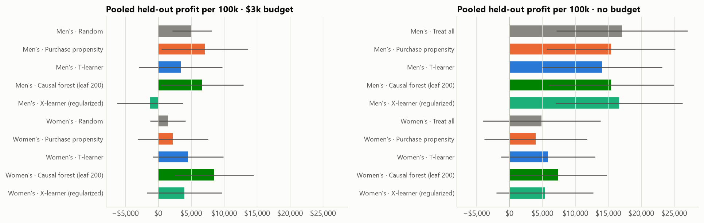
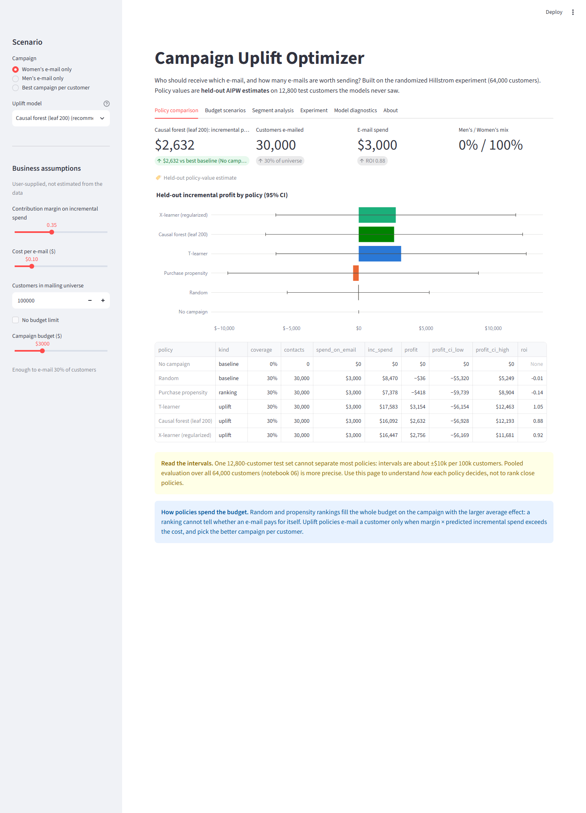

# Marketing Incrementality & Uplift Optimization

**Who should get which e-mail, and is it worth sending at all?** This is a research-grade causal-inference project on Kevin Hillstrom's randomized e-mail experiment: 64,000 customers, three arms. It moves from average treatment effects to customer-level uplift models to budget-constrained profit optimization. Every result is evaluated on held-out randomized data with doubly robust estimators.



## Key findings

| # | Question | Answer |
|---|---|---|
| 1 | Do the e-mails work? | **Yes.** Men's e-mail: **+$0.77** spend per customer (95% CI $0.49–$1.05), +0.68 pp conversion. Women's: **+$0.42** ($0.17–$0.68), +0.31 pp. All six outcome effects are significant after Holm correction. |
| 2 | Does uplift targeting beat purchase-propensity targeting? | **Only where effect heterogeneity exists.** For the Women's e-mail under a $3k budget, a regularized causal forest earns **$8.5k per 100k customers vs $2.2k (propensity) and $1.5k (random)**. The paired gains are +$6.3k (95% CI $0.6k–$11.9k) over propensity and +$7.0k ($2.4k–$11.7k) over random. For the Men's e-mail, nothing beats propensity or random: its spend effect is positive but not detectably heterogeneous. |
| 3 | Can individual effects be estimated reliably? | **Weakly for spend, well for visits.** About 90% of individual causal-forest intervals include zero. Regularization and the **base learner** matter more than the meta-learner. Heavier leaves raise held-out calibration (BLP slope) from ≈0.2–0.3 to ≈0.7–0.8. At default settings (NB03 §4c), a **Random Forest** base learner ranks and calibrates best, and turns the T-learner from no better than random into a top performer. Once every base learner is tuned with equal budgets (NB07), their held-out policy values are statistically tied (see 4b). Trained on visits, uplift models beat the propensity ranking by ~2.5×. |
| 4 | What should the business do? | **No budget cap:** send the Men's e-mail to everyone (≈ $17k profit per 100k). **With a cap:** a causal-forest-targeted Women's e-mail ($8.5k) and a propensity-targeted Men's e-mail ($7.1k) are comparable, with heavily overlapping intervals. Per-customer campaign choice is only as good as the *weaker* of the two effect models. |
| 4b | Which base learner should power the T-learner? | **HistGradientBoosting**, chosen on held-out evidence, not reputation. In nested cross-validated policy evaluation over all 64k customers, it earned **$2.2k per 100k vs $1.5k (Random Forest baseline) and $1.4k (XGBoost)** at the $3k budget. That is a statistical tie (HistGB − RF +$0.7k, 95% CI −$2.4k to +$3.9k), but HistGB fits **2.7× faster than XGBoost and 7.5× faster than Random Forest**. Without a budget cap, Random Forest's better-calibrated effect sizes win, and XGBoost loses $3–5k per 100k. |
| 5 | How robust is this? | **Sample size dominates.** One 12.8k test split gives ±$10k intervals that separate almost nothing, so final claims rest on a pooled 5-fold evaluation over all 64k customers. **The pre-registered selection metric (AUGC) picked the wrong finalist.** A decision-matched metric (budgeted profit plus calibration gate) would have chosen correctly from development data alone. |

These results include two hypotheses that failed: a "calibrated propensity" model, and the AUGC selection rule. Both are reported with the evidence against them. Read the [research report](reports/research_report.md) for the full argument.

## Project flow

| Notebook | Phase | What it does |
|---|---|---|
| [01 · Data & experiment](notebooks/01_data_understanding_experimental_analysis.ipynb) | Data understanding, experimental analysis | Data contract, randomization checks (SRM, SMD, assignment classifier), ATEs with Welch / bootstrap / permutation / Lin-adjusted estimators, Holm correction, MDE, segment effects, heterogeneity Wald test |
| [02 · Baselines](notebooks/02_baseline_models.ipynb) | Baseline models | AIPW evaluation framework, purchase-propensity model, T-learner, random and treat-all policies, why propensity ranks well for one campaign but not the other |
| [03 · Advanced uplift](notebooks/03_advanced_uplift_models.ipynb) | Advanced uplift modeling | S/X/DR-learners with HistGB, Random Forest and XGBoost base learners, causal forest (EconML), calibrated-propensity hypothesis; bootstrap uncertainty, BLP calibration, CI coverage, seed stability, visit-KPI robustness, segment calibration; pre-registered model selection |
| [04 · Policy & budget](notebooks/04_policy_evaluation_optimization.ipynb) | Policy evaluation and optimization | First and only look at the test set: uplift ranking, budget-constrained allocation (greedy, verified against MILP), break-even coverage, per-customer campaign choice, budget curves, margin × cost sensitivity |
| [05 · Dashboard](notebooks/05_interactive_dashboard.ipynb) | Interactive dashboard | Artifact contract, exact reproduction of NB04 by the app's code path, scenario walk-through, headless Streamlit test |
| [07 · Base-learner study](notebooks/07_base_learner_study.ipynb) | Model benchmarking | T-learners on **Random Forest (baseline)**, **XGBoost (primary candidate)** and **HistGradientBoosting (efficiency benchmark)**. Same splits and features, equal 6-config tuning budgets, winner chosen by **nested cross-validated held-out policy value** over all 64k customers, plus fit/predict timing |
| [06 · Final evaluation](notebooks/06_final_evaluation_reproducibility.ipynb) | Research report and deployment | Repeated splits, pooled cross-fitted policy evaluation, post-hoc selection analysis, scorecard, `results.json`, reproducibility record, test run |

## Methods at a glance

* **Estimand:** $\tau_k(x) = E[Y(k) - Y(0) \mid X = x]$ for campaign $k$ vs no e-mail. The primary outcome is spend in dollars, so incremental profit = margin × τ − cost.
* **Evaluation:** cross-fitted AIPW scores $\Gamma_{ik}$, using the **known** randomization probabilities (≈1/3 per arm). Their nuisance models are fitted *inside* each evaluation fold, so no candidate model grades its own predictions. Policy value is $\frac1n\sum_i \pi(X_i)\,\Gamma_{i}$, and policies are compared with **paired** intervals.
* **Base learners:** every meta-learner accepts `base="rf" | "xgb" | "hgb"`. Each is used directly from its library: `sklearn.ensemble.RandomForestRegressor` (baseline), `xgboost.XGBRegressor` through its scikit-learn API (primary candidate), and `sklearn.ensemble.HistGradientBoostingRegressor` (efficiency benchmark and default). Shared regularization knobs are translated per family. NB03 §4c compares them at default settings, and NB07 runs the tuned, nested-CV held-out comparison that picks the winner.
* **Leakage control:** features are pre-treatment only (unit-tested). A 20% test set is touched only in NB04, and model selection uses 5-fold cross-fitting on the 80% development set.
* **Optimization:** with equal contact costs, giving each customer their best arm, keeping positive net value, and admitting customers in order of net value until the budget binds is exactly optimal. NB04 checks this against SciPy's HiGHS MILP.
* **Economics** are explicit, user-supplied assumptions: 35% margin, $0.10 per e-mail, $3k budget per 100k customers. Every conclusion is shown under alternatives.

## Interactive dashboard

```powershell
streamlit run app/dashboard.py
```



| Tab | Purpose |
|---|---|
| Policy comparison | Held-out profit and 95% CI for every policy under your margin, cost, budget and campaign choice |
| Budget scenarios | Profit vs. budget curves; margin × cost advantage heatmap |
| Segment analysis | Observed vs. model-predicted uplift by segment, and who the policy targets |
| Experiment | ATEs and randomization checks |
| Model diagnostics | Test-set gain curves, AUGC, BLP calibration, Qini |

The app never retrains anything. Sliders re-run the allocation rule on frozen test-set scores, and every number carries an evidence label: *observed experimental estimate*, *held-out policy value*, *model prediction*, *business assumption*, or *simulated scenario*. Notebook 05 checks that the app reproduces notebook 04 to the cent.

**Deploying:** the five small, derived files the app needs (`artifacts/test_*.csv|json`, `artifacts/ate_table.csv`) are committed, and raw data is not. The app therefore runs on Streamlit Community Cloud straight from the repository, with `app/dashboard.py` as the entry point and `requirements.txt` for dependencies.

## Reproduce

Requires Python 3.11 (EconML had no 3.14 wheels at build time).

```powershell
py -3.11 -m venv .venv
.\.venv\Scripts\Activate.ps1
pip install -r requirements.txt

# data: place the original CSV at Data/Kevin_Hillstrom_MineThatData.csv
# (or data/raw/); source URL is in src/config.py

pytest                                   # 54 tests: data contract, estimators, base learners, benchmark, optimizer
jupyter nbconvert --to notebook --execute --inplace notebooks/0*.ipynb
streamlit run app/dashboard.py
```

Running all notebooks takes about 25 minutes on a laptop CPU. Seeds, split fractions, the data file's SHA-256 and package versions are recorded in [`reports/reproducibility.json`](reports/reproducibility.json). Headline numbers are written by NB06 to [`reports/results.json`](reports/results.json).

## Repository layout

```text
src/                 importable pipeline (notebooks call these; they don't duplicate them)
  config.py          frozen experiment config: arms, outcome, seeds, economics
  data.py            loading, data contract, features, stratified splits / folds
  inference.py       ATE estimators, balance, SRM, MDE, Holm, segment effects
  models.py          purchase propensity, S/T/X/DR-learners, calibrated propensity, causal forest
  evaluation.py      AIPW/IPW scores, policy gain, gain & Qini curves, BLP calibration
  optimization.py    net value, budgeted multi-arm allocation, MILP check, paired comparisons
  pipeline.py        cross-fitting and fit-and-score shared by NB02–07
  benchmark.py       base-learner study: tuning grids, nested CV, timing (NB07)
  scenario.py        policy scenarios shared by NB04/05 and the dashboard
  plotting.py        one chart style for every figure
notebooks/           01–07, executed with outputs
app/dashboard.py     Streamlit decision tool
tests/               pytest suite
reports/             research report, figures, results.json, reproducibility.json
Docs/                original project brief and architecture plan
```

## Data

Kevin Hillstrom, *MineThatData E-Mail Analytics and Data Mining Challenge* (2008): 64,000 customers who purchased in the prior 12 months, randomized to a Men's merchandise e-mail, a Women's merchandise e-mail, or no e-mail, with visits, conversions and spend tracked for two weeks. The file is distributed by the author for analysis. It is not redistributed here, so download it from the source URL in `src/config.py`.

## Limitations

The data is a single retailer in 2008 over a two-week window, and the economics are assumptions. Policy values are unbiased held-out estimates for this population, not guarantees. A production rollout should run the chosen policy against a randomized holdout and monitor realized lift. See §7 of the report.
