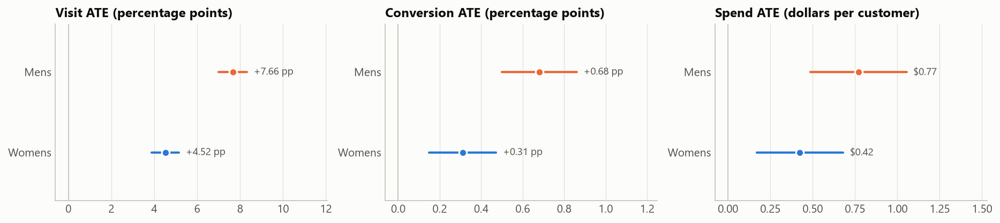
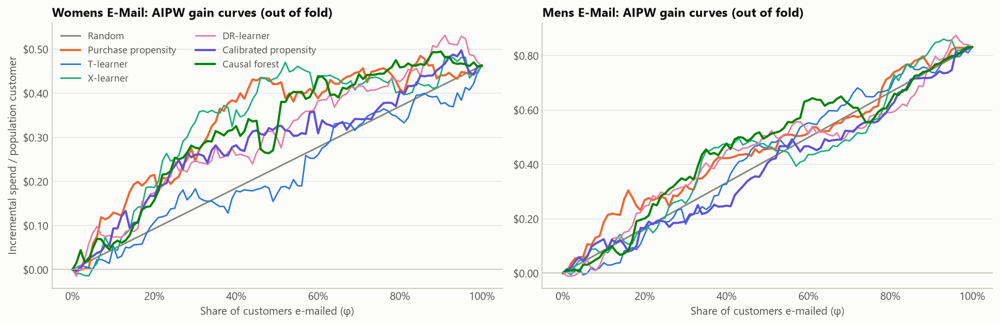

# Marketing Incrementality & Uplift Optimization: Research Report

*Hillstrom MineThatData E-Mail Analytics Challenge · 64,000 randomized customers · all numbers generated by notebooks 01–06 (see `reports/results.json`)*

---

## 0 · Executive summary

**Decision question.** A retailer can send a Men's merchandise e-mail, a Women's merchandise e-mail, or nothing. Which customers should get which e-mail, and how much should be spent?

**Answer.**

1. **Both e-mails cause incremental spend.** Men's: +$0.77 per customer (95% CI $0.49–$1.05). Women's: +$0.42 ($0.17–$0.68).
2. **With no budget cap, send the Men's e-mail to everyone.** Its effect is positive and roughly uniform, and broad mailing earns about **$17k of contribution per 100k customers** (pooled held-out estimate). No targeting rule beats it.
3. **Under a tight budget, target the Women's e-mail with an uplift model.** At a $3k budget per 100k customers, a regularized causal forest earns about **$8.5k vs $2.2k for purchase-propensity targeting and $1.5k for random**. The paired gain over propensity targeting is +$6.3k (95% CI $0.6k–$11.9k). The Women's e-mail has real, learnable effect heterogeneity: new customers, women's-merchandise buyers and multichannel buyers respond most.
4. **Do not pick the campaign per customer with these models.** The Men's effect model carries no signal, so mixing it in adds noise rather than value.

**What this project demonstrates beyond the answer:**

* Uplift modelling pays off only where heterogeneity exists, and this can be tested *before* modelling (NB01 Wald test).
* The model-selection metric must match the decision it drives.
* A single 20% test split was too small to rank policies, and the pooled evaluation design used instead is described in §5.4.

---

## 1 · Problem and hypotheses

Conventional targeting scores *who will buy*. Profit depends on *who will buy because of the e-mail*. The two differ whenever some customers would buy anyway ("sure things") or would not buy regardless ("lost causes").

| RQ | Question | Pre-stated hypothesis |
|---|---|---|
| 1 | What is the average effect of each campaign on conversion and spend? | Both positive |
| 2 | Does uplift targeting beat propensity targeting on held-out data? | Yes |
| 3 | How reliably can heterogeneous effects be estimated? | Moderately; with large uncertainty for spend |
| 4 | Which policy maximizes incremental profit under budget constraints? | An uplift policy with per-customer campaign choice |
| 5 | How sensitive are the conclusions? | Robust to the economics; sensitive to noise |

Hypothesis 2 was only partly supported and hypothesis 4 was rejected. Both outcomes are reported below.

## 2 · Data and experimental validity (NB01)

* **Population:** 64,000 customers who bought in the last 12 months, randomized in equal thirds (21,307 Men's / 21,387 Women's / 21,306 control).
* **Outcomes:** visit, conversion and spend, measured over two weeks.
* **Pre-treatment features:** recency, past-year spend, merchandise categories bought, new-customer flag, area type, and purchase channel.

| Check | Result |
|---|---|
| Data contract (schema, labels, ranges, logical consistency) | Pass; no missing values; no spend without conversion |
| Sample-ratio mismatch vs. 1/3 each | χ² = 0.20, p = 0.90 |
| Covariate balance | max \|SMD\| = 0.014 over 12 features × 2 arms |
| Can features predict assignment? | Logistic AUC = 0.50 / 0.50 |

Randomization was implemented correctly, so differences in means are unbiased causal estimates, and the assignment probabilities (≈ 1/3) are known.

**Key data property:** only 0.9% of customers buy, and buyers spend $30–$499. Spend has SD ≈ $15 against a mean ≈ $1. This rarity drives every statistical difficulty later.

## 3 · Average effects (RQ1)

| Campaign | Visit | Conversion | Spend / customer | Relative spend lift |
|---|---|---|---|---|
| Men's | +7.66 pp | +0.68 pp | **+$0.77** ($0.49–$1.05) | +118% |
| Women's | +4.52 pp | +0.31 pp | **+$0.42** ($0.17–$0.68) | +65% |

* **Agreement across estimators:** bootstrap intervals, randomization-inference p-values and Lin regression adjustment all agree with the Welch analysis. All six effects survive Holm correction.
* **Head-to-head:** Men's beats Women's on every outcome (spend difference $0.35, p = 0.03).
* **Mechanism:** the extra spend comes from *more buyers*, not larger baskets. Spend per buyer is about $114–$122 in every arm.
* **Precision:** regression adjustment reduces variance by < 3%, because the features explain little of the outcome. On a 20% test split, the spend MDE (≈ $0.82) is about **twice** the Women's ATE. This foreshadows §5.4.
* **Heterogeneity test:** a joint Wald test of treatment × covariate interactions rejects homogeneity for visits in both arms. For spend, it finds moderate evidence for the Women's e-mail (p = 0.014) and **none for the Men's (p = 0.57)**.

## 4 · Methodology

### 4.1 Estimand and economics
The estimand is $\tau_k(x)=E[Y(k)-Y(0)\mid X=x]$, with $Y$ = two-week spend. Expected incremental profit of contacting customer $i$ with campaign $k$ is $m\,\hat\tau_{ik}-c$. The margin $m$ = 35%, cost $c$ = $0.10, and budget $B$ = $3,000 per 100k customers are **assumptions**, varied in §6.

### 4.2 Partitions and leakage control
* An 80% **development** set is split into 5 stratified folds, and every model selection decision uses out-of-fold predictions only.
* A 20% **test** set is touched once, in NB04, after the pipeline is frozen in `artifacts/model_selection.json`.
* Features are pre-treatment only, which a unit test enforces. The dashboard receives no raw outcomes.

### 4.3 Policy evaluation
Individual effects are never observed, so every policy is valued with cross-fitted **AIPW** scores:

$$\Gamma_{ik}=\hat\mu_k(X_i)-\hat\mu_0(X_i)+\frac{\mathbb 1[A_i=k](Y_i-\hat\mu_k(X_i))}{e_k}-\frac{\mathbb 1[A_i=0](Y_i-\hat\mu_0(X_i))}{e_0}$$

* **Known propensities:** $e_k$ is known by design, so $E[\Gamma_{ik}\mid X_i]=\tau_k(X_i)$ even if $\hat\mu$ is wrong.
* **Independent nuisance models:** $\hat\mu$ is fitted *within* each evaluation fold, independently of every candidate model.
* **Policy value:** a policy's value is $\frac1n\sum_i\Gamma_{i,\pi(i)}$, with CLT intervals.
* **Paired comparisons:** policies are compared on the same customers, so their difference gets a tighter paired interval.
* **Check:** IPW gives the same answers within noise (NB04 §3c).

### 4.4 Models
| Family | Models |
|---|---|
| Conventional | Purchase propensity: gradient-boosted P(buy \| X, e-mailed) |
| Meta-learners | S-, T-, X-learner (Künzel et al. 2019), DR-learner (Kennedy 2020), each with default and regularized base learners |
| Forest | Causal forest (`econml.CausalForestDML`): honest, residualized, with pointwise CIs; leaf 50 and leaf 200 |
| Structured | Calibrated propensity: τ = a + b·p(x), DR-calibrated (hypothesis) |
| Base learners | Every meta-learner runs on Random Forest (baseline), XGBoost (primary candidate) or HistGradientBoosting (efficiency benchmark and default), via `base="rf" \| "xgb" \| "hgb"`, with leaf-size and leaf-count regularization translated per family. NB07 selects among them on nested-CV held-out policy value |

### 4.5 Optimization
The allocation problem is to maximize $\sum_{i,k}a_{ik}(m\hat\tau_{ik}-c)$ subject to $\sum a_{ik}c\le B$ and at most one campaign per customer. With a common cost, a greedy rule is exactly optimal: give each customer their best arm, keep positive net value, and admit customers in order of net value until $B$ binds. NB04 confirms this against an exact HiGHS MILP (identical objective; 2 ms vs 13 s).

## 5 · Results

### 5.1 Ranking quality on development data (NB02–03)

| Model | Mean AUGC ($/customer above random) | Women's BLP slope | Men's BLP slope |
|---|---|---|---|
| Purchase propensity | **+0.076** | n/a (not in $) | n/a |
| X-learner (regularized) | +0.073 | 0.69 | 0.00 |
| Causal forest (leaf 200) | +0.071 | 0.79 | 0.31 |
| Causal forest | +0.066 | 0.34 | 0.14 |
| X-learner | +0.058 | 0.22 | 0.09 |
| DR-learner | +0.047 | 0.27 | 0.04 |
| Calibrated propensity | +0.013 | 1.02 | −0.24 |
| S-learner | +0.011 | 0.14 | −0.15 |
| T-learner | −0.002 | −0.09 | −0.04 |

Findings:

* **The purchase-propensity score is a strong uplift ranking for the Women's e-mail, but for an incidental reason.** It ranks e-mailed buyers (AUC 0.57) better than control buyers (0.53). In other words, it has learned *responsiveness*, because baseline demand is barely predictable from these features. For the Men's e-mail it ranks control buyers *better* (0.62 vs 0.58), learning "sure things", and its edge disappears. Whether propensity works is a campaign-specific accident that only a control group can reveal.
* **Regularization matters more than the algorithm.** Heavier leaf constraints roughly triple the BLP slopes of the X-learner and causal forest. Unregularized learners have slopes near 0: their dollar predictions are noise.
* **Uncertainty is large.** Bootstrap 95% intervals of AUGC overlap for every model. About 90% of individual causal-forest CATE intervals include zero.
* **Stability:** the regularized causal forest is the most seed-stable model (rank correlation 0.96 across seeds; top-30% Jaccard 0.84). The T-learner (0.67) and DR-learner (0.60) are the least stable.
* **The KPI matters.** Trained on visits (16× more events), T/X/forest models reach ≈ 2.5× the propensity ranking's AUGC and beat random by 5–7 standard errors. The spend difficulty is signal-to-noise, not method.
* **Base learner matters as much as meta-learner** (NB03 §4c; a development-data sensitivity analysis added after selection was frozen). Each T-, X- and DR-learner variant was re-fitted with three base learners on the same folds:

  | Base learner (mean over 4 learners) | Mean AUGC | Women's BLP | Dev profit@30% per 100k |
  |---|---|---|---|
  | HistGradientBoosting | +0.044 | 0.27 | $6.4k |
  | **Random Forest** | **+0.076** | **0.57** | **$7.5k** |
  | XGBoost | +0.042 | 0.13 | $5.8k |

  * **Ranking and calibration:** Random Forest improves both. It turns the T-learner from no better than random (AUGC −0.002) into a top performer (+0.074), and gives the only meaningful Men's calibration in the project (regularized X-learner, BLP ≈ 0.4).
  * **Why:** bagging averages many independently fitted trees, which cancels the noise of a 0.9%-buyer outcome. Boosting fits residuals sequentially and chases rare large purchases.
  * **XGBoost caveat:** it ran a fixed 300 rounds without early stopping, which partly explains its weak calibration.
  * **No clear winner for the decision:** on budgeted profit, the best combinations are within about $0.9k of each other, well inside one standard error (≈ $3.4k).
* **Calibrated propensity failed.** Its two parameters are unstable across training samples, and in one Men's fold the slope turned negative, inverting the ranking. The hypothesis is rejected.
* **Segment level vs individual level:** model segment averages track observed segment effects closely (T-learner r = 0.98) even when individual rankings are noise. Most real heterogeneity lies *between coarse segments*.

**Pre-registered selection** (highest mean AUGC among dollar-valued models): **X-learner (regularized)**. The challenger is the causal forest (leaf 200).

### 5.2 Single test split (NB04)
* **Ranking replicates for Women's:** on the test set, the X-learner and causal forest beat propensity on Women's ranking (AUGC +0.12 vs −0.04), with BLP slopes 0.81 and 0.93.
* **No campaign-level gain for Men's:** every model was at or below random for the Men's e-mail.
* **The test set is too small to rank policies.** Every profit interval was about ±$10k per 100k, and no paired comparison was significant.
* **Unlucky split:** this split's ATEs ($0.28 / $0.52) sit well below the development estimates.

### 5.3 Repeated splits (NB06 §1)
Re-running the frozen pipeline on 5 more random splits gives profit SDs of $3–8k *across splits* for the same policy. Any single-split ranking of close policies is unreliable.

### 5.4 Pooled cross-fitted evaluation: the primary result (NB06 §1c)
Every customer is used exactly once as held-out data. Frozen models are fitted on 4/5 of the data, the policy is formed and valued on the remaining 1/5, and contributions from all 64,000 customers are pooled. This roughly halves the standard error relative to one test split.

| Profit per 100k customers (95% CI) | Random / Treat all | Purchase propensity | Causal forest (leaf 200) | X-learner (reg.) |
|---|---|---|---|---|
| **Women's, $3k budget** | $1.5k (−1.2k, 4.2k) | $2.2k (−3.1k, 7.5k) | **$8.5k (2.5k, 14.5k)** | $4.0k (−1.7k, 9.7k) |
| **Men's, $3k budget** | $5.1k (2.1k, 8.1k) | $7.1k (0.5k, 13.6k) | $6.7k (0.4k, 12.9k) | −$1.2k (−6.3k, 3.8k) |
| Women's, no budget | $4.9k | $4.0k | $7.4k | $5.4k |
| **Men's, no budget** | **$17.1k (7.1k, 27.1k)** | $15.4k | $15.4k | $16.7k |

*Random* applies under the budget and *treat all* without one. The paired comparisons are in `artifacts/crossfit_paired.csv`.

* **Women's:** the causal forest's advantage is the largest targeting effect in the study, and it is statistically significant. Paired gains are **+$7.0k over random (95% CI $2.4k–$11.7k, z = 2.96)** and **+$6.3k over purchase propensity ($0.6k–$11.9k, z = 2.17)** per 100k customers.
* **Men's:** no uplift policy beats broad or propensity mailing. The selected X-learner is *significantly worse* than random under the budget (paired z ≈ −2.9).
* **Per-customer campaign choice** with these models underperforms simply choosing the better campaign. One of the two effect models is noise, and an argmax over noisy CATEs is biased toward the noisier arm.

### 5.5 The selection-metric lesson (NB06 §1e)
The pre-registered AUGC criterion averaged a strong Women's ranking with a useless Men's one. Re-scoring the two finalists on **development data only**, with a decision-matched criterion (budgeted profit at 30% coverage, averaged over campaigns, plus a positive-BLP gate), selects the **causal forest**. The X-learner's Men's BLP slope of 0.004 already flagged it before any test data was seen. This analysis is post hoc and labelled as such. It is the most transferable lesson of the project: **select uplift models on the metric of the decision they will drive.**

### 5.6 Base-learner study: Random Forest vs XGBoost vs HistGradientBoosting (NB07)

**Question:** which regressor should power the T-learner, chosen on held-out causal-policy performance rather than reputation?

| Role | Base learner | Implementation |
|---|---|---|
| Baseline | Random Forest | `sklearn.ensemble.RandomForestRegressor` |
| Primary candidate | XGBoost | `xgboost.XGBRegressor` (scikit-learn API) |
| Efficiency benchmark | HistGradientBoosting | `sklearn.ensemble.HistGradientBoostingRegressor` |

**Protocol:**
* The same 12 pre-treatment features, splits, AIPW scores and economics for every base learner.
* An equal tuning budget: 6 configurations per learner, scored on budgeted profit.
* Primary evaluation by **nested cross-validation over all 64,000 customers**. The configuration is chosen by inner 3-fold CV on the training part of each of 5 outer folds, so every customer is held out exactly once.
* Winner rule, declared in advance: highest pooled held-out profit at the $3k budget, averaged over campaigns.

| Held-out (nested CV), per 100k | Random Forest | XGBoost | HistGB |
|---|---|---|---|
| Profit @ $3k, Women's | $3.8k | $1.7k | $3.9k |
| Profit @ $3k, Men's | −$0.9k | $1.2k | $0.5k |
| **Profit @ $3k, mean** | $1.5k | $1.4k | **$2.2k** |
| Profit, no budget, Women's / Men's | **$7.0k / $13.9k** | $3.7k / $8.6k | $6.3k / $12.6k |
| Women's held-out AUGC | **+0.070** | −0.012 | +0.052 |
| Mean fit time per T-learner | 0.81 s (7.5×) | 0.29 s (2.7×) | **0.11 s (1×)** |

* **Winner: HistGradientBoosting**, but it is a statistical tie at the budget. Paired HistGB − RF = +$0.7k (95% CI −$2.4k to +$3.9k); XGBoost − RF = −$0.01k.
* **Without a budget, Random Forest is best and XGBoost clearly worst** (−$3k to −$5k vs RF, z ≈ −1.8 to −1.9). In that setting the break-even rule depends on calibrated effect sizes, and XGBoost's dollar predictions were the least calibrated.
* **HistGB is the most efficient** (2.7× faster than XGBoost, 7.5× faster than RF to fit, 18× faster than RF to predict) and the most tuning-stable: it picked the same leaf count in every outer fold.
* **Why the "strongest" algorithm did not win:** a T-learner differences two models of a 0.9%-nonzero outcome, so the base learner that fits the least noise wins. Aggressive boosting without early stopping fits noise.
* **Decision:** keep HistGB as the T-learner base learner. Prefer RF when a policy relies on break-even thresholds. Do not adopt XGBoost for this outcome without early stopping and a held-out re-test.
* **Consistency check:** these tuned results differ from the default-settings comparison in NB03 §4c, where RF calibrated best. That shift shows the differences are small relative to noise.

## 6 · Sensitivity to the economics (NB04 §6, dashboard)

* **Margin and cost:** profit rises with margin and falls with cost as expected. On the single test split, the selected policy's advantage over propensity targeting is positive or near zero for costs up to $0.20, and clearly negative at $0.30, where few contacts pay for themselves. A single split is noisy, so read this as direction, not magnitude.
* **Break-even rule:** without a budget, the uplift models' own break-even rule chooses ≈ 50–70% coverage for the Women's e-mail and ≈ 80–95% for the Men's. This is the decision a ranking alone cannot make.
* **Budget curves** flatten once every customer with positive predicted net value has been reached. The dashboard lets a user explore this for any assumptions, and labels the result a *simulated scenario on held-out data*.

## 7 · Limitations and threats to validity

| Threat | Impact | Mitigation |
|---|---|---|
| External validity: one retailer, 2008, two-week window | Effects, costs and channels differ today | Treat as a method demonstration; re-estimate on current data |
| Short outcome window | Long-run effects (fatigue, unsubscribes, later purchases) unobserved | Cost per e-mail includes an allowance; a production test should track 60–90 days |
| Rare, heavy-tailed outcome | Wide intervals; close policies indistinguishable | Pooled cross-fitted evaluation; paired comparisons; visit as a secondary KPI |
| Selection/evaluation overlap in the pooled analysis | Finalist comparison could be mildly optimistic | The bias would favour the *pre-registered* pick, which still lost; comparisons vs random/propensity are unaffected |
| Multiple comparisons in segment analysis | False-positive segments | Holm correction within families; segments framed as hypotheses |
| Assumed economics | Profit levels depend on inputs | Explicit assumptions; sensitivity heatmaps; dashboard sliders |

## 8 · Recommendations and next steps

1. **Production decision:** mail the Men's campaign broadly. If budget is constrained, give the Women's campaign to the customers ranked highest by the regularized causal forest.
2. **Validate prospectively.** Run the policy against a randomized holdout, for example 10% random allocation and 10% no-e-mail. At this effect size, detecting a $5k per 100k profit difference at 80% power needs on the order of 150–200k customers per arm. Plan the test duration accordingly.
3. **Improve the signal.** Model a two-stage objective (visit → purchase), which this report shows is learnable. Add richer pre-treatment features: e-mail engagement history, category affinity, tenure.
4. **Change the selection protocol.** Use budgeted profit per campaign plus a calibration gate as the pre-registered criterion for future model selection.
5. **Shrink CATEs toward the ATE using their BLP slope** before forming policies. This was identified post hoc and needs fresh data to validate.

## 9 · Reproducibility

`requirements.txt` pins every package version used (Python 3.11). Seeds, split fractions, the data SHA-256 and package versions are recorded in `reports/reproducibility.json`. All reported numbers are produced by code, collected in `reports/results.json`, and regenerated by running the seven notebooks in order (~25 minutes). The pytest suite (54 tests) covers the data contract, leakage, estimator correctness on synthetic data for every base learner, the budget constraint, greedy-vs-MILP optimality and profit accounting.

### References
* Hillstrom, K. (2008). *The MineThatData E-Mail Analytics and Data Mining Challenge.*
* Künzel, S., Sekhon, J., Bickel, P., Yu, B. (2019). Metalearners for estimating heterogeneous treatment effects. *PNAS.*
* Kennedy, E. (2020). Towards optimal doubly robust estimation of heterogeneous causal effects. *arXiv:2004.14497.*
* Wager, S., Athey, S. (2018). Estimation and inference of heterogeneous treatment effects using random forests. *JASA.*
* Chernozhukov, V., Demirer, M., Duflo, E., Fernández-Val, I. (2018). Generic machine learning inference on heterogeneous treatment effects. *arXiv:1712.04802.*
* Lin, W. (2013). Agnostic notes on regression adjustments to experimental data. *Annals of Applied Statistics.*
* Athey, S., Wager, S. (2021). Policy learning with observational data. *Econometrica.*
